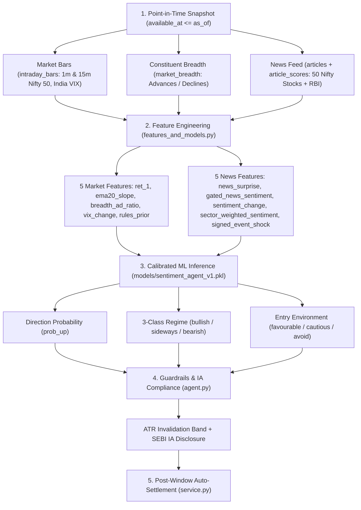

# How the Nifty 50 Market Sentiment Agent Computes & Settles Predictions

This document provides the complete technical and mathematical specification of how a single prediction is computed, guarded, and settled across the codebase (`ingest.py`, `market_data.py`, `scorer.py`, `features_and_models.py`, `agent.py`, and `service.py`).

---

## 1. End-to-End Architecture

---

## 2. Step-by-Step Prediction Pipeline

### Step 1: Point-in-Time Data Snapshot (`available_at <= as_of`)
When a prediction is requested for a forward horizon $W \in \{1, 5, 15, 30, 60\}$ minutes at cutoff timestamp $t = \text{as\_of}$:
1. **Live Incremental Refresh (`refresh_live_snapshot` in `agent.py`)**:
   - If the database snapshot is older than 45 seconds, it pulls the latest `1m` (`interval_sec = 60`) and `15m` (`interval_sec = 900`) candles for `NIFTY50` and `INDIAVIX`, plus the latest headlines from `https://news.lisuns.com`.
2. **Base Bar Resolution (`build_intraday_window_dataset` in `features_and_models.py`)**:
   - **Short horizons (`1m`, `5m`)**: Uses 1-minute bars (`interval_sec = 60`) and 1-minute breadth (`universe = 'NIFTY50'`).
   - **Standard horizons (`15m`, `30m`, `60m`)**: Uses 15-minute bars (`interval_sec = 900`) and 15-minute breadth (`universe = 'NIFTY50_15M'`).
3. **Strict Point-in-Time Rule**:
   - Every bar and news article is filtered by `available_at <= as_of` (`0` lookahead violations).

---

### Step 2: Hybrid News Scoring (`scorer.py`)
Each article in `articles` is scored once into `article_scores`:
1. **Text Extraction**: Prioritizes company-specific `specific_title` from the Lisuns API alongside `title` and `summary`.
2. **Sentiment Polarity (`sentiment_score` $\in [-1.0, +1.0]$)**:
   - Word-boundary regex matching against curated Indian financial positive/negative lexicons, blended $75\% / 25\%$ with the raw vendor sentiment tag.
3. **Index-Weight Relevance (`nifty_relevance` $\in [0.0, 1.0]$)**:
   $$\text{nifty\_relevance} = \min\left(1.0,\; 0.35 + \frac{\text{index\_weight}}{12.0}\right)$$
   - Heavyweights (`HDFCBANK`, `RELIANCE`, `ICICIBANK`, `INFY`, `TCS`) and RBI/macro stories receive `0.75 – 0.95` relevance.
4. **Event Shock Detection (`is_event`, `event_severity`)**:
   - Flags macro/policy, regulatory, M&A, and earnings shocks with severity $\in [0.0, 1.0]$.

---

### Step 3: The 10 Orthogonalized Model Features (`features_and_models.py`)

#### A. 5 Market & Technical Features (`MARKET_COLS`)
| Feature | Formula | Role |
| :--- | :--- | :--- |
| `ret_1` | $\ln(\text{Close}_t / \text{Close}_{t-1})$ | Latest window return / short-term momentum |
| `ema20_slope` | $(\text{EMA}_{20,t} - \text{EMA}_{20,t-3}) / \text{EMA}_{20,t-3}$ | Intraday trend slope |
| `breadth_ad_ratio` | $(\text{Advances}_t - \text{Declines}_t) / (\text{Advances}_t + \text{Declines}_t)$ | Nifty 50 constituent advance/decline participation |
| `vix_change` | $(\text{VIX}_t - \text{VIX}_{t-1}) / \text{VIX}_{t-1}$ | Intraday implied volatility change |
| `rules_prior` | Rule-based technical score centered at `0.0` (`EMA-20`, `MACD`, `RSI-14`, `VWAP`, `Breadth`, `VIX`) | Technical analysis baseline prior |

#### B. 5 Decayed News Features (`NEWS_SCORER_COLS`)
Articles in $(t - 12\text{h},\; t]$ are weighted by $w_i = \exp(-\Delta t_{\text{hours}} / 6.0) \times \text{nifty\_relevance}_i \times \text{confidence}_i$:

| Feature | Formula | Role |
| :--- | :--- | :--- |
| `news_surprise` | $\text{Sentiment}_{\text{last 1.5h}} - \text{Sentiment}_{\text{12h decayed}}$ | Short-term headline tone shift vs 12h baseline |
| `gated_news_sentiment` | $\text{Sentiment}_{\text{last 1.5h}} \times \tanh(\ln(1 + N_{\text{articles}}) / 2)$ | Volume-gated recent sentiment |
| `sentiment_change` | $\text{Sentiment}_{\text{0–12h}} - \text{Sentiment}_{\text{12–24h}}$ | Multi-session news momentum |
| `sector_weighted_sentiment` | $0.45 S_{\text{Banking}} + 0.30 S_{\text{IT}} + 0.25 S_{\text{Energy}}$ | Sentiment across the top 3 Nifty sector blocks |
| `signed_event_shock` | $\max(\text{event\_severity}) \times \text{sign}(\text{Sentiment}_{\text{last 1.5h}})$ | Directional impulse from high-severity events |

---

### Step 4: Model Inference & Output Contract (`agent.py`)
1. **Directional Probability (`prob_up`)**:
   - Computed by the calibrated `HistGradientBoostingClassifier + LogisticRegression` hybrid ensemble (`models/sentiment_agent_v1.pkl`), with log-odds shrinkage toward the base rate ($p_0 \approx 0.525$) to keep intraday probabilities well-calibrated within $[0.35, 0.65]$.
2. **3-Class Market Regime (`regime`, `prob_bullish`, `prob_sideways`, `prob_bearish`)**:
   - Combines the 3-class regime model probabilities with `adx` (trend strength) and `prob_up` (directional conviction).
3. **Entry Environment (`entry_score`, `entry_condition`)**:
   - Classifies the trading environment as `favourable`, `cautious`, or `avoid` based on directional conviction, ADX trend strength, VIX stability, and absence of unpriced event shocks.
4. **ATR-Scaled Invalidation Band (`invalidation`)**:
   - Uses window ATR ($\text{ATR}_{\text{pts}} = \text{Spot} \times \text{atr\_pct}$) and VWAP to set objective price invalidation thresholds.

---

### Step 5: Automatic Post-Window Settlement (`service.py`)
Once $\text{NOW()} \ge \text{horizon\_end}$:
1. Looks up the actual 1-minute Nifty 50 close at `horizon_start` (`start_price`) and `horizon_end` (`end_price`).
2. Computes $\text{realized\_return} = \ln(\text{end\_price} / \text{start\_price})$ and classifies `realized_regime` using the window's noise threshold (`0.025%` for `1m`, `0.06%` for `5m`, `0.10%` for `15m`, `0.15%` for `30m/60m`).
3. Grades the prediction as:
   - **`✅ HIT`**: Predicted `regime` matched `realized_regime`.
   - **`✅ DIR HIT`**: Predicted directional tilt (`prob_up >= 50%` vs `< 50%`) matched the sign of `realized_return`.
   - **`❌ MISS`**: Neither regime nor directional tilt matched.

